<div align="center">

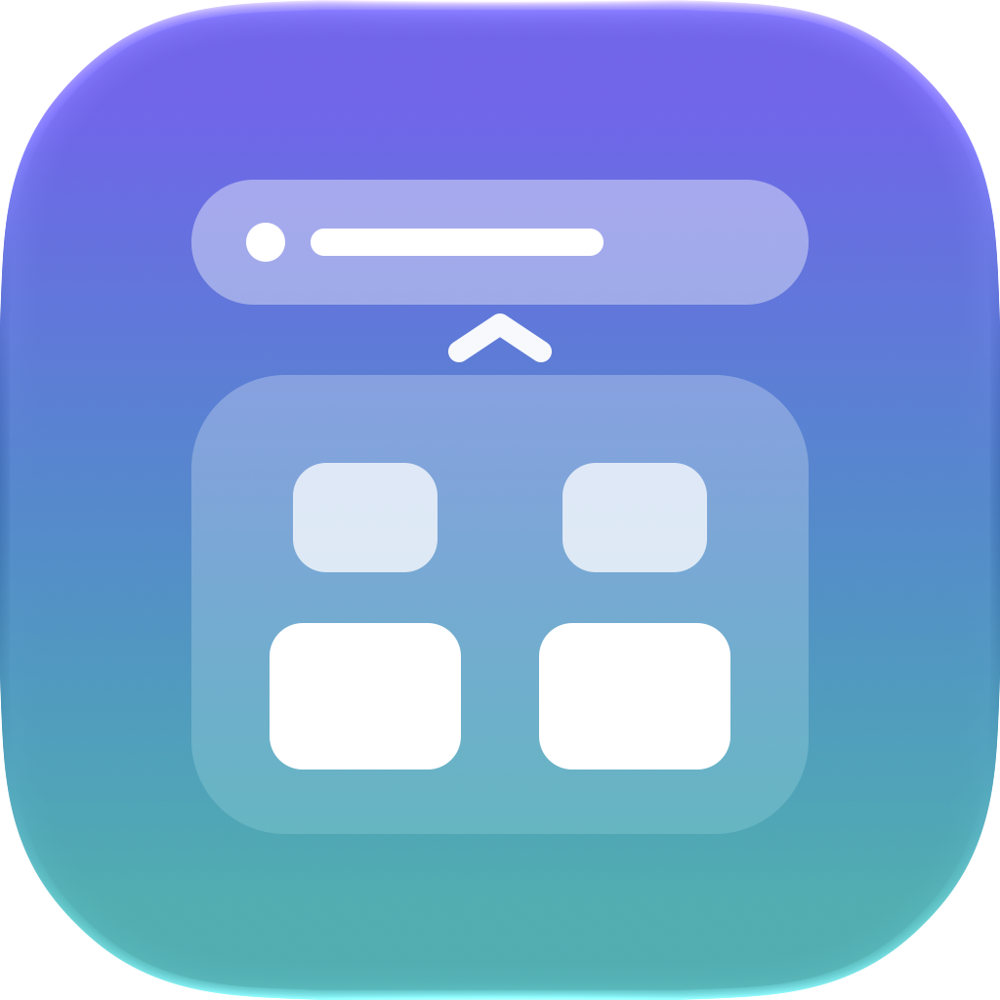

<h1>Tuck</h1>

<p><b>Tuck your desktop clutter into a pane of glass.</b><br>A free, open-source macOS desktop organizer: Liquid Glass zones, menu bar only, never touches your original files.</p>

<p><a href="README.md">中文</a> · <b>English</b></p>

[](https://github.com/3520566741-YCLi/tuck-for-mac/releases/latest)
[](https://github.com/3520566741-YCLi/tuck-for-mac/releases/latest)
[](LICENSE)


[](https://github.com/3520566741-YCLi/tuck-for-mac/stargazers)

<h3><a href="https://github.com/3520566741-YCLi/tuck-for-mac/releases/latest">⬇︎ Download the latest Tuck</a></h3>

<a href="#gallery">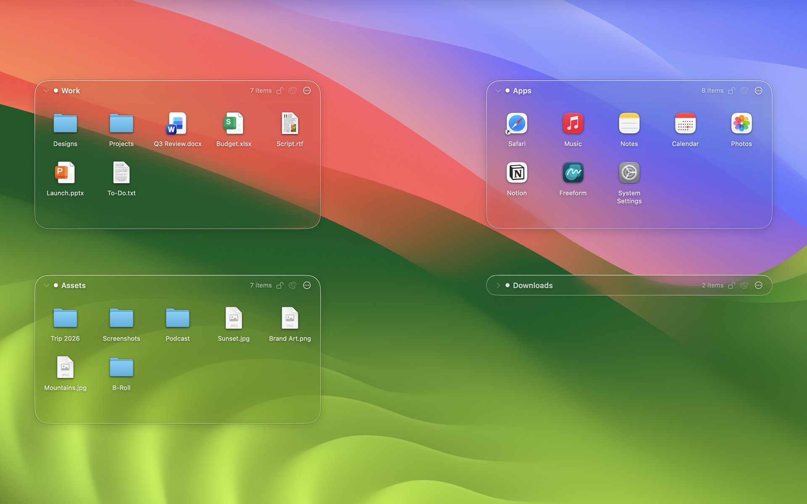</a>

<p><a href="#features">Features</a> · <a href="#gallery">Gallery</a> · <a href="#install">Install</a> · <a href="#faq">FAQ</a> · <a href="#contributing">Contributing</a> · <a href="#-release-history">Releases</a></p>

</div>

## Latest

**v2.4.0** (2026-11-26): **any newly saved file can go into a download zone** (browser downloads, Save As from a web page, saves from other apps into the Desktop or Downloads), **screenshots optional** (tick “Include Screenshots” and pick their zone), and the Appearance panel is readable in daytime too. v2.3.0 brought glass per zone and download zones. See [how to use the new features](#how-to-use-the-new-features-v23) below and every version in the [release history](#-release-history).

## How to use the new features (v2.3)

**Glass per zone**
- Where: the **palette button** on the right of a zone's title bar (the same panel as colour and opacity).
- Glass: Clear / Frosted / Dark; Refraction: Off / Edge / Fluted; Edge: Thin rim / Highlight / Thick edge. Each click changes only that zone; hover an option to see what it does.
- The menu bar's global Glass Style setting is gone: after updating, every zone keeps its current look, and new zones start as Clear + Edge + Thin rim. The menu bar's Glass Effects submenu keeps just two switches: “Refract dynamic wallpapers too” and “Light follows the lid angle”.

**Download zones**
- Where: Tuck menu bar icon › New Zone › **Download Zone…**
- Creates a real folder inside the “Tuck Zones” folder in your Home (you can drag it to the Finder sidebar), e.g. `~/Tuck Zones/Downloads`. Everything in it shows in the zone, newest first; files still downloading don't.
- Tuck never deletes this folder, and deleting the zone doesn't delete its files.

**Move new downloads into a zone** (off by default; any way of saving counts since v2.4)
- Where: Tuck menu bar icon › **Move New Downloads Into** › pick a download zone, or “New Download Zone and Move Here…”.
- Once on, new files saved to Downloads or the Desktop, whether a browser download (Safari, Chrome, Edge, Firefox, Arc…), a Save As from a web page, or a save from another app, are **moved** into the zone's folder about 2 seconds later and don't stay behind, so there's only one copy. No browser settings to change. This is the only place Tuck moves files, and only when you turn it on.
- Only files newly created and fully written after turning it on: in-progress temp files (.download, .crdownload, .part, .opdownload…), Office ~$ lock files and files an app still has open are left alone, as are existing files, old files moved in from elsewhere, and files you drag back out of the zone.
- Screenshots aren't collected by default: tick **Include Screenshots** in the same menu, and optionally pick which download zone they go to (the same zone by default).
- The first time, Tuck explains this once, then macOS asks whether Tuck may read your Downloads folder: click Allow. If you clicked Don't Allow: System Settings › Privacy & Security › Files & Folders › Tuck › turn on Downloads Folder, then pick the zone again.
- To put one back: **Undo Last Move** (⌘Z) in the menu bar returns the latest move, or just drag the file out of the zone. Name clashes get a number and nothing is overwritten; deleting in the zone moves to the Trash; when Tuck quits the files stay in the zone's folder.

## What it is

Picture a few **clear glass trays** on your desktop:

- They float above desktop icons and below normal windows.
- Drag a file in and an **entry** appears; the original **stays where it is** and is only hidden on the desktop.
- A tray **collapses into a glass capsule** and opens again with one click.
- Quit Tuck and the desktop is exactly as before. If Tuck crashes, a 2 MB watchdog puts the hidden icons back.

## Features

| | Feature | In short |
|---|---|---|
| 🪟 | **Liquid Glass zones** | Native Liquid Glass (macOS 26+, frosted blur on older systems). Pick the glass **per zone**: Clear / Frosted / Dark (the palette button on each zone's title bar). |
| 🔍 | **Glass that refracts** | Bends the wallpaper behind it like real glass: **edge stretch** (default) or **fluted glass** (vertical ribs). Edge: Thin rim / Highlight / Thick edge; on a MacBook the highlight **follows the lid angle**. |
| 💊 | **Collapse to a capsule** | Click the arrow by the title; the zone shrinks bottom-up into a glass capsule with a spring animation. |
| 📁 | **Three zone types** | Virtual zones keep entries only · App zones hold favourite apps · Folder zones are backed by a real folder. |
| 🫥 | **No duplicates** | Desktop files placed in a zone are hidden on the desktop and come back when removed or when Tuck quits. |
| 🖱️ | **Works like Finder** | Select, double-click, Space for Quick Look, ⌘O / ⌘A / ⌘C; drop into folders or onto apps. **Finder's context menu**: Open With, Get Info, Rename, Duplicate, Make Alias, Compress, Tags, Services; deleting only moves to the Trash and ⌘Z undoes it. |
| 🗂️ | **“Tuck Zones” folder** | Links to the originals in your Home folder, zone by zone, so other apps' Open / Upload dialogs can find tucked files. |
| 📥 | **Download zones** | New Zone › Download Zone: a real folder inside “Tuck Zones” whose files all show in the zone, also reachable from the Finder sidebar. |
| ⬇️ | **Move new downloads into a zone** | Menu “Move New Downloads Into”: finished downloads from any browser (in Downloads or on the Desktop) move into a download zone automatically, no browser settings to change; undoable, off by default. |
| 🔀 | **Drag to reorder** | Icons make room like a phone home screen; hover over a folder to drop in. |
| 🔤 | **Auto sort** | Sort By name / kind / date / size, reversible, per zone; display order only, nothing is renamed or moved. |
| 👀 | **Peek** | `⌃⌥D` lifts all zones above every window. |
| 🪶 | **Featherweight** | 0% CPU at idle (wakes only on folder changes), about 22 MB of memory, zero dependencies, no network. |

## Gallery

> Real screenshots on a Mac, with demo files. They show Tuck's English interface, which follows your system language (since v2.2.0).

#### Follows dark mode
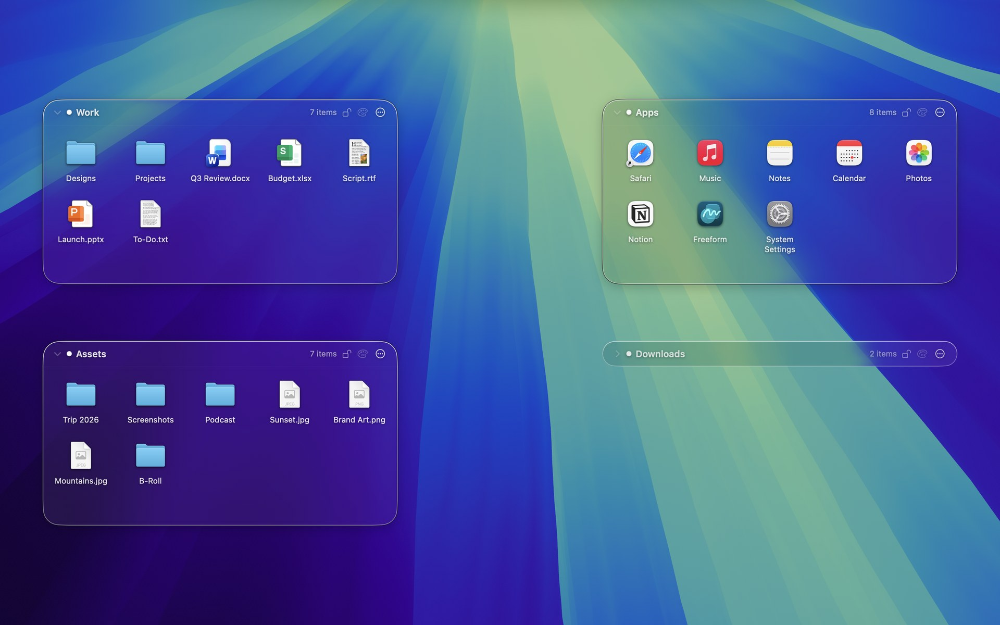

#### Three glass styles
| B Frosted | C Dark |
|:---:|:---:|
| 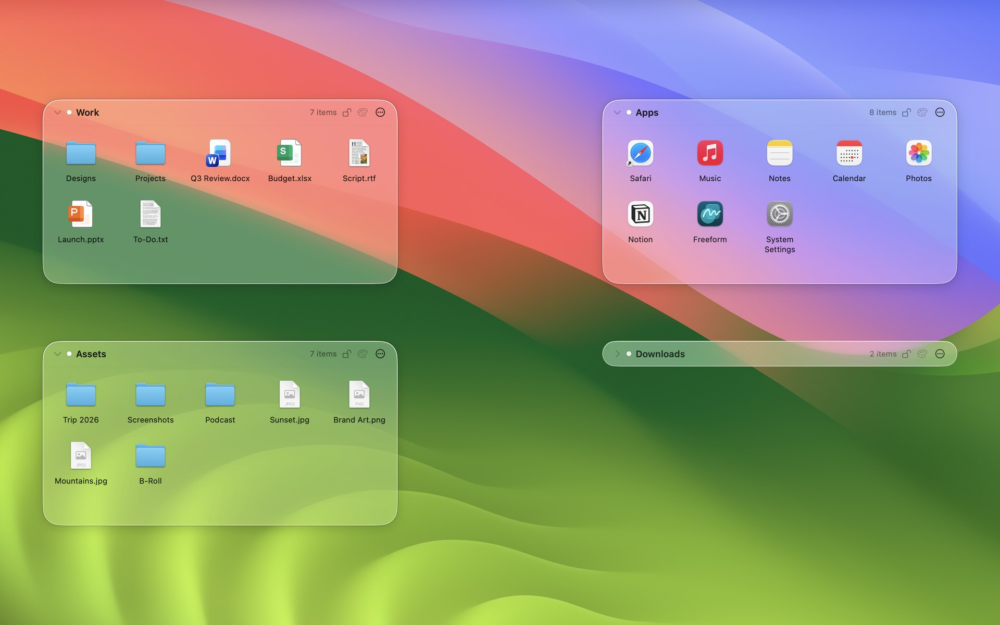 | 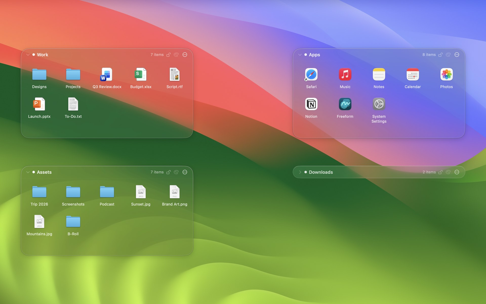 |

#### Capsules · menu bar
| Expanded and capsules | Menu bar menu |
|:---:|:---:|
| 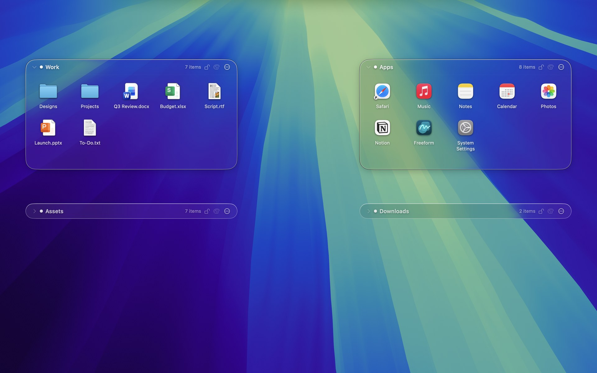 | 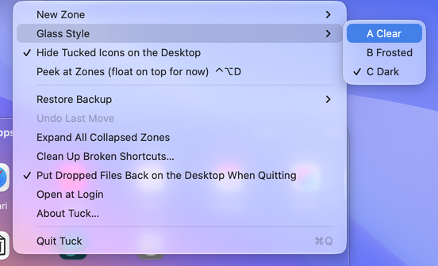 |

#### Glass that refracts <sup>v2.2</sup>
| Edge stretch (default) | Fluted glass |
|:---:|:---:|
| 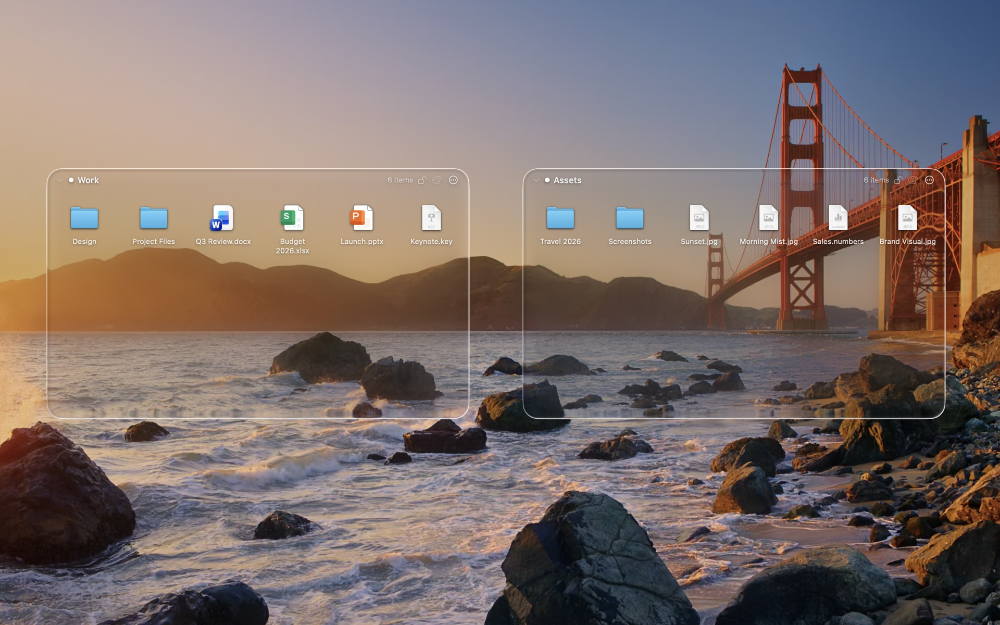 | 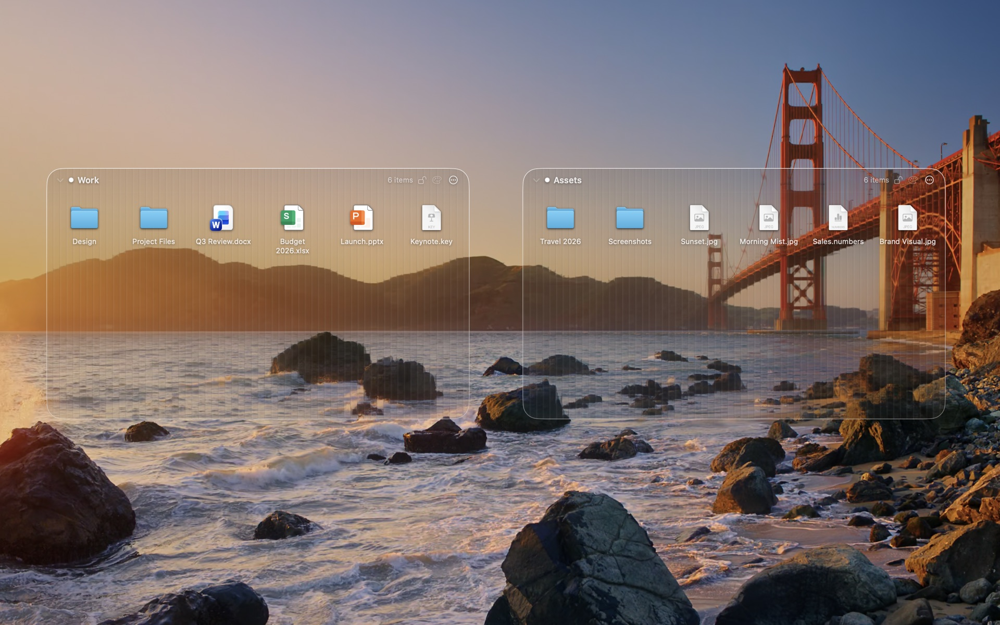 |

#### “Tuck Zones” folder <sup>v2.2</sup>
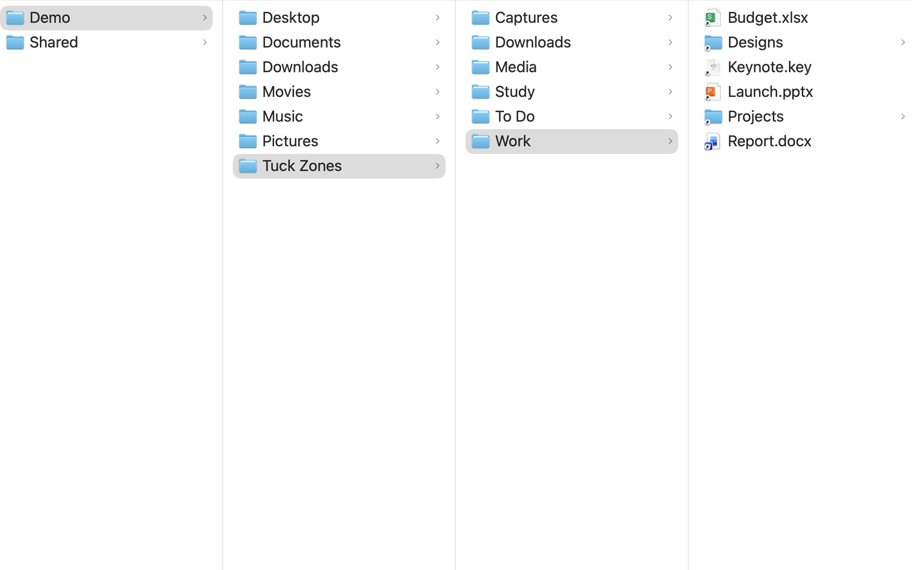

#### Glass per zone · Download zone <sup>v2.3 / v2.4</sup>
| Glass, refraction and edge per zone | New downloads and Save As land in the Downloads zone |
|:---:|:---:|
| 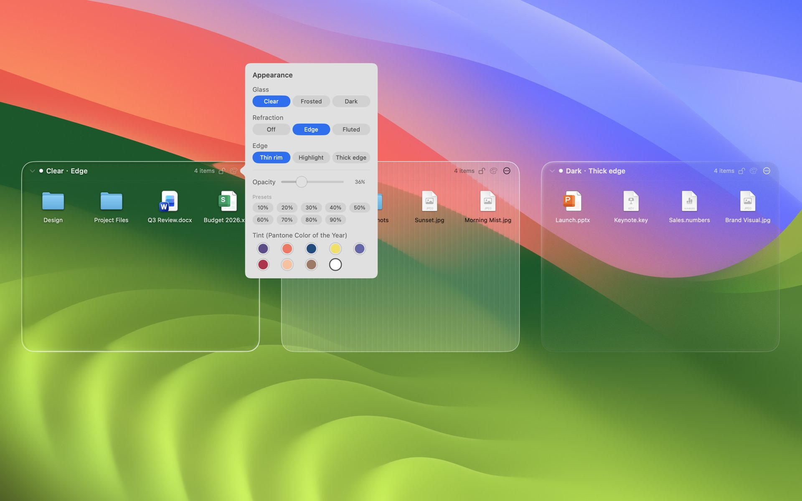 | 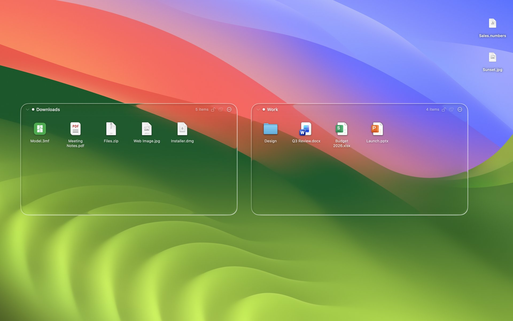 |

## Install

### Download (recommended)

1. Download `Tuck-x.y.z.zip` from the [latest release](https://github.com/3520566741-YCLi/tuck-for-mac/releases/latest) and unzip it.
2. Drag `Tuck.app` into Applications.
3. First launch: **right-click Tuck → Open** in Applications (it isn't signed with a paid developer ID, so macOS asks once).
4. Click the grid icon in the menu bar → **New Zone**, and drag desktop files in.

Every old version stays in [Releases](https://github.com/3520566741-YCLi/tuck-for-mac/releases) so you can roll back. Versions follow [Semantic Versioning](https://semver.org/).

### Build from source / hand it to your AI

Requires full Xcode 26. You can also hand the repository to your AI coding assistant and point it at [AI_SETUP.en.md](AI_SETUP.en.md).

```sh
git clone https://github.com/3520566741-YCLi/tuck-for-mac.git && cd tuck-for-mac
swift test --disable-sandbox --cache-path .spm-cache   # run the tests
./scripts/package-app.sh --install                      # build and install to /Applications
```

## FAQ

<details><summary><b>Will it touch my files?</b></summary>

Virtual and app zones **only store entries and never move originals**. Hiding on the desktop just sets the Finder hidden flag (like `chflags hidden`); nothing is renamed, moved or changed. Only a folder zone you create yourself moves dropped files into its folder, Cancel is the default on name conflicts, and replaced files go to the Trash so you can undo.
</details>

<details><summary><b>If Tuck crashes, do my desktop icons stay hidden?</b></summary>

No. Tuck starts a ~2 MB watchdog that restores the icons Tuck hid if Tuck quits unexpectedly. It only restores what Tuck hid; files you hid yourself are left alone.
</details>

<details><summary><b>Why isn't it in the Dock?</b></summary>

Tuck lives in the menu bar only; every setting is behind the grid icon. Opening Tuck again from Launchpad pops up that menu.
</details>

<details><summary><b>Older macOS?</b></summary>

macOS 14 and later work; Liquid Glass needs macOS 26, older systems get the system frosted blur.
</details>

<details><summary><b>What permissions does it need? Does it watch my screen?</b></summary>

**None by default**, and it never goes online. Only if you turn on “Refract dynamic wallpapers too” does it ask once for Screen Recording: macOS doesn't share dynamic / aerial wallpapers with apps, so Tuck captures only the wallpaper layer (never windows, desktop icons or files), in memory only, never saved. With a still-image wallpaper it isn't needed. Because Tuck has no paid developer signature, macOS may ask you to allow it again after each update.
</details>

<details><summary><b>What is the “Tuck Zones” folder in my Home folder?</b></summary>

Desktop files tucked into a zone are hidden on the desktop, and that hiding applies to every app, so other apps' Open / Upload dialogs couldn't see them. “Tuck Zones” lists links to the originals, zone by zone; open it in an upload dialog to pick the original. Deleting a link never deletes the original. Turn it off with “Keep a ‘Tuck Zones’ folder in Home” in the menu bar menu.
</details>

<details><summary><b>Does it launch at login?</b></summary>

Not by default. Turn on "Launch at Login" in the menu bar menu if you want it.
</details>

<details><summary><b>A file icon has a black square behind it?</b></summary>

Tuck shows the icon macOS provides. Some apps (for example a third-party default app for PDFs) ship icons with an opaque background, and Finder shows the same.
</details>

## Roadmap

- [ ] Tabs inside a zone
- [ ] Optional rules that tidy new files (off by default)
- [ ] More glass tints

## Contributing

Issues and PRs welcome; see [CONTRIBUTING.md](CONTRIBUTING.md). Report security issues privately as described in [SECURITY.md](SECURITY.md).

## Credits

Product behaviour inspired by [DesktopFramesPlus](https://github.com/limbo666/DesktopFramesPlus) (MIT) on Windows. Tuck is a Swift / AppKit rewrite for macOS and copies none of its code. See [THIRD_PARTY_NOTICES.md](THIRD_PARTY_NOTICES.md).

## 📦 Release history

| Version | Date | What changed | Download |
|---|---|---|---|
| **v2.4.0** `latest` | 2026-11-26 | Save As and other apps' saves also go into download zones, optional screenshots, Appearance panel readable in daytime · [details](CHANGELOG.md#v240--2026-11-26) | [Download](https://github.com/3520566741-YCLi/tuck-for-mac/releases/tag/v2.4.0) |
| **v2.3.0** | 2026-11-24 | Glass per zone, download zones, move new downloads into a zone (any browser) · [details](CHANGELOG.md#v230--2026-11-24) | [Download](https://github.com/3520566741-YCLi/tuck-for-mac/releases/tag/v2.3.0) |
| **v2.2.0** | 2026-11-24 | More realistic liquid glass, auto sort, glass that refracts (edge stretch / fluted, dynamic wallpapers too), new edge lights + lid-angle highlight, Finder-style context menu, “Tuck Zones” folder, English interface · [details](CHANGELOG.md#v220--2026-11-24) | [Download](https://github.com/3520566741-YCLi/tuck-for-mac/releases/tag/v2.2.0) |
| **v2.1.0** | 2026-11-08 | First public release: Liquid Glass zones in three styles, capsules, desktop auto-hide, Finder-style items, crash watchdog · [details](CHANGELOG.md#v210--2026-11-08) | [Download](https://github.com/3520566741-YCLi/tuck-for-mac/releases/tag/v2.1.0) |

Every version stays on [Releases](https://github.com/3520566741-YCLi/tuck-for-mac/releases); each release page has the installer under **Assets**.

## License

[MIT](LICENSE)
