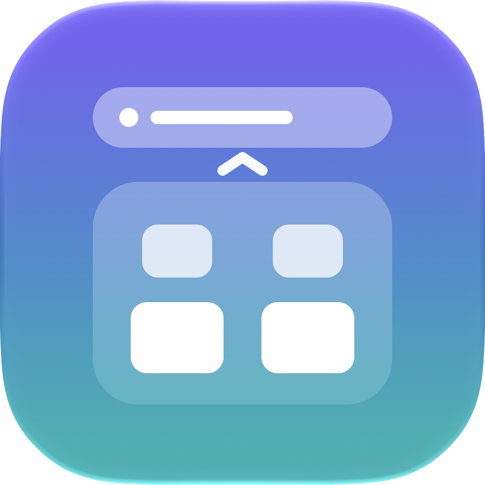
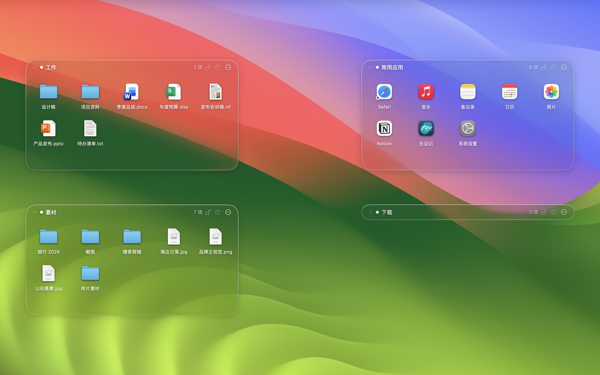
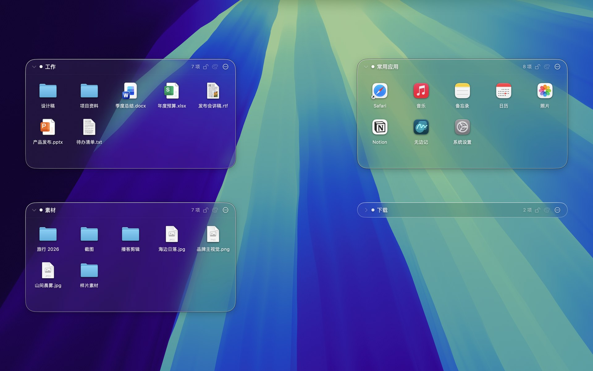
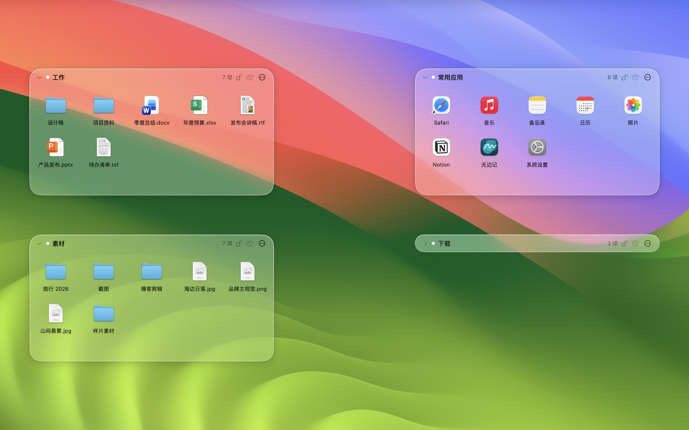
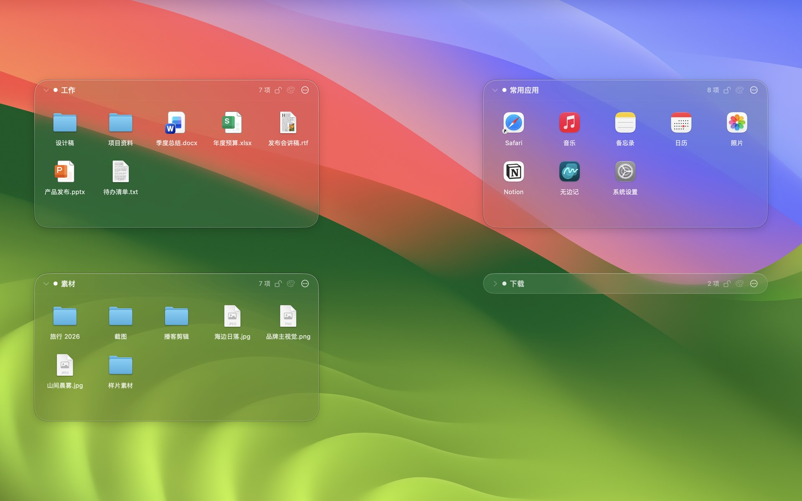
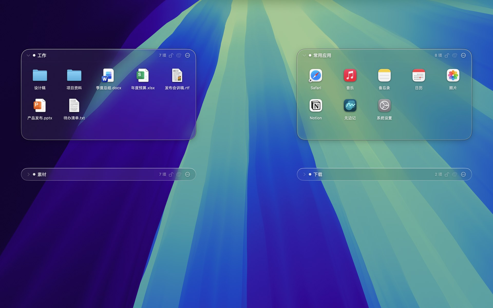
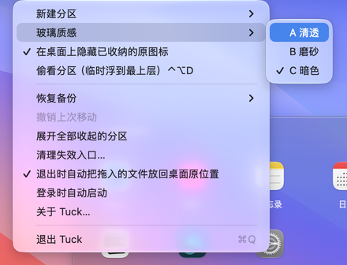

<div align="center">



<h1>Tuck</h1>

<p><b>Tuck your desktop clutter into a pane of glass.</b><br>A free, open-source macOS desktop organizer: Liquid Glass zones, menu bar only, never touches your original files.</p>

<p><a href="README.md">中文</a> · <b>English</b></p>

[](https://github.com/3520566741-YCLi/tuck-for-mac/releases/latest)
[](https://github.com/3520566741-YCLi/tuck-for-mac/releases/latest)
[](LICENSE)


[](https://github.com/3520566741-YCLi/tuck-for-mac/stargazers)

<h3><a href="https://github.com/3520566741-YCLi/tuck-for-mac/releases/latest">⬇︎ Download the latest Tuck</a></h3>

<a href="#gallery"></a>

<p><a href="#features">Features</a> · <a href="#gallery">Gallery</a> · <a href="#install">Install</a> · <a href="#faq">FAQ</a> · <a href="#contributing">Contributing</a> · <a href="#-release-history">Releases</a></p>

</div>

## Latest

**v2.1.0** (first public release): Liquid Glass zones in three styles, capsules, desktop auto-hide, Finder-style items, drag to reorder, crash watchdog. Every version is in the [release history](#-release-history) below; full notes in the [CHANGELOG](CHANGELOG.md).

## What it is

Picture a few **clear glass trays** on your desktop:

- They float above desktop icons and below normal windows.
- Drag a file in and an **entry** appears; the original **stays where it is** and is only hidden on the desktop.
- A tray **collapses into a glass capsule** and opens again with one click.
- Quit Tuck and the desktop is exactly as before. If Tuck crashes, a 2 MB watchdog puts the hidden icons back.

## Features

| | Feature | In short |
|---|---|---|
| 🪟 | **Liquid Glass zones** | Native Liquid Glass (macOS 26+, frosted blur on older systems). Three looks: **A Clear / B Frosted / C Dark**. |
| 💊 | **Collapse to a capsule** | Click the arrow by the title; the zone shrinks bottom-up into a glass capsule with a spring animation. |
| 📁 | **Three zone types** | Virtual zones keep entries only · App zones hold favourite apps · Folder zones are backed by a real folder. |
| 🫥 | **No duplicates** | Desktop files placed in a zone are hidden on the desktop and come back when removed or when Tuck quits. |
| 🖱️ | **Works like Finder** | Select, double-click, Space for Quick Look, ⌘O / ⌘A / ⌘C; drop into folders or onto apps. |
| 🔀 | **Drag to reorder** | Icons make room like a phone home screen; hover over a folder to drop in. |
| 👀 | **Peek** | `⌃⌥D` lifts all zones above every window. |
| 🪶 | **Featherweight** | 0% CPU at idle (wakes only on folder changes), about 22 MB of memory, zero dependencies, no network. |

## Gallery

> Real screenshots on a Mac, with demo files.

#### Follows dark mode


#### Three glass styles
| B Frosted | C Dark |
|:---:|:---:|
|  |  |

#### Capsules · menu bar
| Expanded and capsules | Menu bar menu |
|:---:|:---:|
|  |  |

## Install

### Download (recommended)

1. Download `Tuck-x.y.z.zip` from the [latest release](https://github.com/3520566741-YCLi/tuck-for-mac/releases/latest) and unzip it.
2. Drag `Tuck.app` into Applications.
3. First launch: **right-click Tuck → Open** in Applications (it isn't signed with a paid developer ID, so macOS asks once).
4. Click the grid icon in the menu bar → **New Zone**, and drag desktop files in.

Every old version stays in [Releases](https://github.com/3520566741-YCLi/tuck-for-mac/releases) so you can roll back. Versions follow [Semantic Versioning](https://semver.org/).

### Build from source / hand it to your AI

Requires full Xcode 26. You can also hand the repository to your AI coding assistant and point it at [AI_SETUP.en.md](AI_SETUP.en.md).

```sh
git clone https://github.com/3520566741-YCLi/tuck-for-mac.git && cd tuck-for-mac
swift test --disable-sandbox --cache-path .spm-cache   # run the tests
./scripts/package-app.sh --install                      # build and install to /Applications
```

## FAQ

<details><summary><b>Will it touch my files?</b></summary>

Virtual and app zones **only store entries and never move originals**. Hiding on the desktop just sets the Finder hidden flag (like `chflags hidden`); nothing is renamed, moved or changed. Only a folder zone you create yourself moves dropped files into its folder, Cancel is the default on name conflicts, and replaced files go to the Trash so you can undo.
</details>

<details><summary><b>If Tuck crashes, do my desktop icons stay hidden?</b></summary>

No. Tuck starts a ~2 MB watchdog that restores the icons Tuck hid if Tuck quits unexpectedly. It only restores what Tuck hid; files you hid yourself are left alone.
</details>

<details><summary><b>Why isn't it in the Dock?</b></summary>

Tuck lives in the menu bar only; every setting is behind the grid icon. Opening Tuck again from Launchpad pops up that menu.
</details>

<details><summary><b>Older macOS?</b></summary>

macOS 14 and later work; Liquid Glass needs macOS 26, older systems get the system frosted blur.
</details>

<details><summary><b>Does it launch at login?</b></summary>

Not by default. Turn on "Launch at Login" in the menu bar menu if you want it.
</details>

<details><summary><b>A file icon has a black square behind it?</b></summary>

Tuck shows the icon macOS provides. Some apps (for example a third-party default app for PDFs) ship icons with an opaque background, and Finder shows the same.
</details>

## Roadmap

- [ ] Tabs inside a zone
- [ ] Optional rules that tidy new files (off by default)
- [ ] More glass tints

## Contributing

Issues and PRs welcome; see [CONTRIBUTING.md](CONTRIBUTING.md). Report security issues privately as described in [SECURITY.md](SECURITY.md).

## Credits

Product behaviour inspired by [DesktopFramesPlus](https://github.com/limbo666/DesktopFramesPlus) (MIT) on Windows. Tuck is a Swift / AppKit rewrite for macOS and copies none of its code. See [THIRD_PARTY_NOTICES.md](THIRD_PARTY_NOTICES.md).

## 📦 Release history

| Version | Date | What changed | Download |
|---|---|---|---|
| **v2.1.0** `latest` | 2026-11-08 | First public release: Liquid Glass zones in three styles, capsules, desktop auto-hide, Finder-style items, crash watchdog · [details](CHANGELOG.md#v210--2026-11-08) | [Download](https://github.com/3520566741-YCLi/tuck-for-mac/releases/tag/v2.1.0) |

Every version stays on [Releases](https://github.com/3520566741-YCLi/tuck-for-mac/releases); each release page has the installer under **Assets**.

## License

[MIT](LICENSE)
