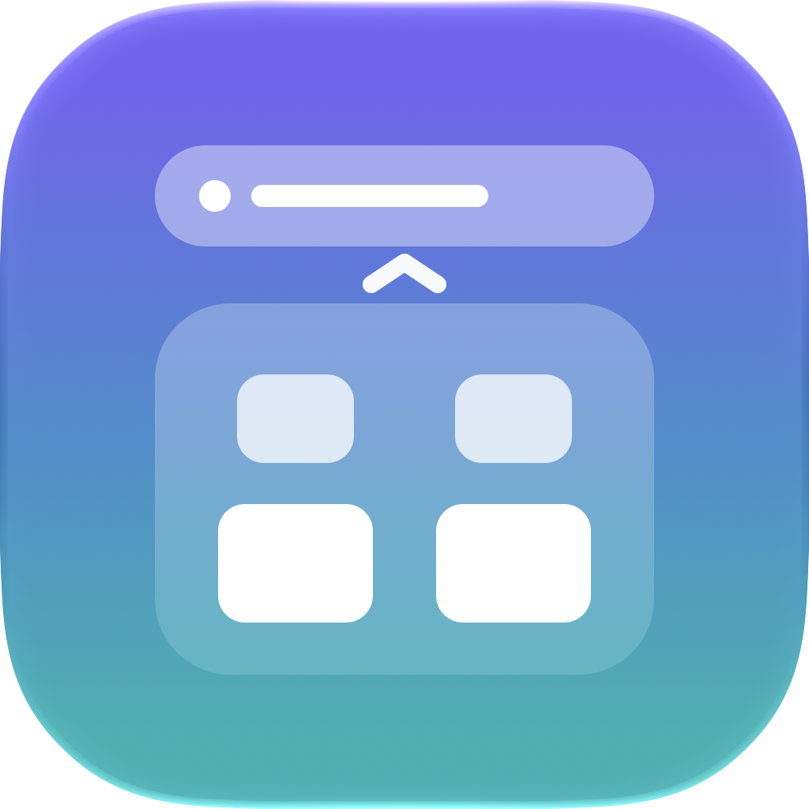
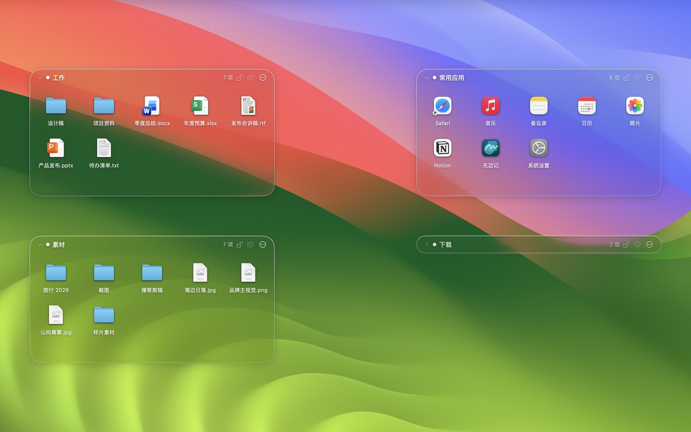
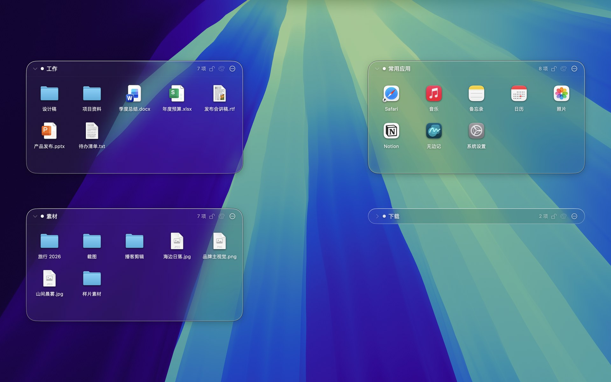
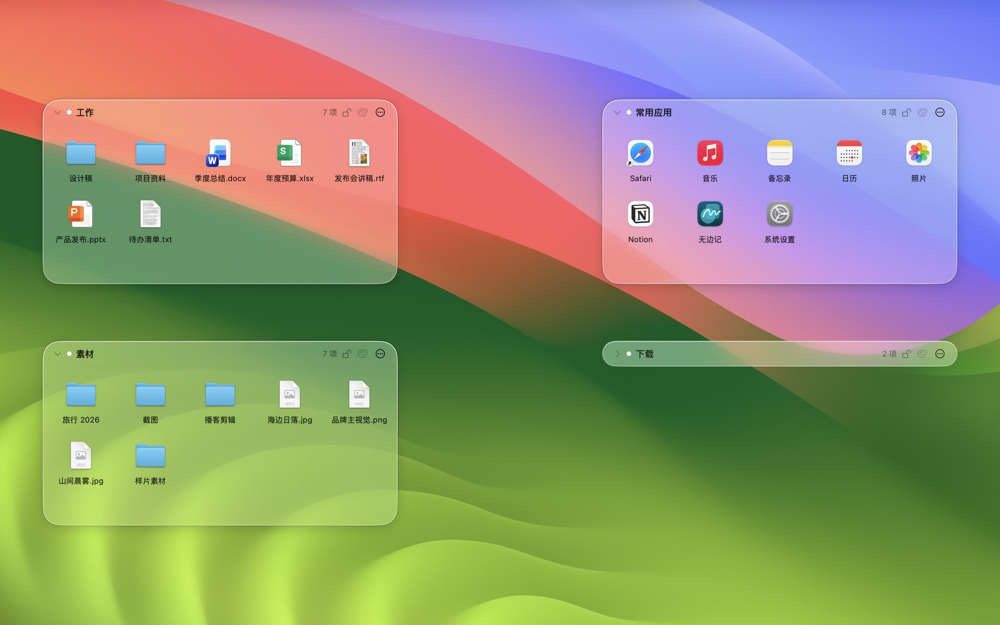
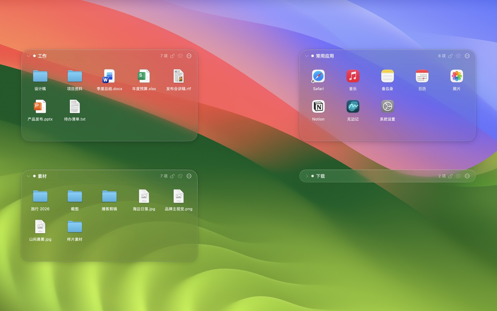
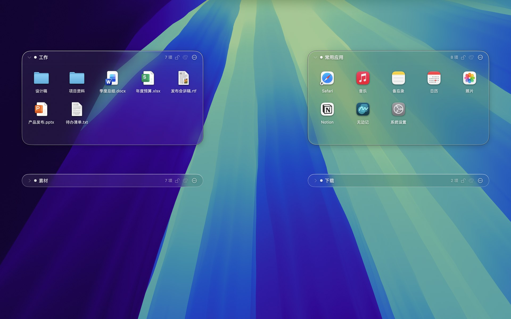
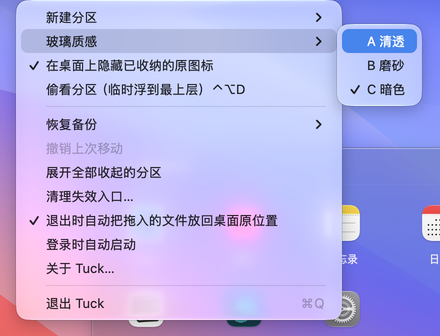

<div align="center">



<h1>Tuck</h1>

<p><b>把桌面上的东西，轻轻收进一块玻璃里。</b><br>免费开源的 macOS 桌面分区工具：液态玻璃、只在菜单栏、不动你的原文件。</p>

<p><b>中文</b> · <a href="README.en.md">English</a></p>

[](https://github.com/3520566741-YCLi/tuck-for-mac/releases/latest)
[](https://github.com/3520566741-YCLi/tuck-for-mac/releases/latest)
[](LICENSE)


[](https://github.com/3520566741-YCLi/tuck-for-mac/stargazers)

<h3><a href="https://github.com/3520566741-YCLi/tuck-for-mac/releases/latest">⬇︎ 下载最新版 Tuck</a></h3>

<a href="#画廊"></a>

<p><a href="#它能做什么">功能</a> · <a href="#画廊">画廊</a> · <a href="#安装">安装</a> · <a href="#常见问题">常见问题</a> · <a href="#参与贡献">参与贡献</a> · <a href="#-版本历史--releases">版本历史</a></p>

</div>

## 最近更新

**v2.1.0**（第一次公开发布）：液态玻璃分区三种质感、收成胶囊、桌面自动隐藏、像访达一样操作、分区内拖动排序、崩溃看门狗。全部版本见下方 [版本历史](#-版本历史--releases)，完整记录见 [CHANGELOG](CHANGELOG.md)。

## 它是什么

想象桌面上放了几个**透明的玻璃收纳盒**：

- 盒子浮在桌面图标上面、普通窗口下面；
- 把文件拖进盒子，盒子里出现它的**入口**，原文件**留在原地不动**，只是在桌面上被悄悄藏起来；
- 盒子可以一下**收成一颗玻璃胶囊**，要用时再点开；
- 关掉 Tuck，桌面一切恢复原样；就算 Tuck 崩溃，一个 2MB 的小看门狗也会把藏起来的图标放回来。

## 它能做什么

| | 功能 | 一句话 |
|---|---|---|
| 🪟 | **液态玻璃分区** | 系统原生 Liquid Glass（macOS 26+，旧系统自动换成毛玻璃）。三种质感一键切换：**A 清透 / B 磨砂 / C 暗色**。 |
| 💊 | **收起成胶囊** | 点标题左边的箭头，从下往上收成玻璃胶囊，弹簧动效；再点恢复原尺寸。 |
| 📁 | **三种分区** | 普通分区只存入口 · 应用分区放常用 App · 文件分区关联一个真实文件夹。 |
| 🫥 | **桌面不重复** | 放进分区的桌面文件，在桌面上自动隐藏；拿出来或退出 Tuck 就恢复。 |
| 🖱️ | **像访达一样用** | 选中、双击打开、空格快速查看、⌘O / ⌘A / ⌘C；拖进文件夹、拖到 App 上打开。 |
| 🔀 | **拖动排序** | 像手机桌面一样让位；在文件夹正中停一下就放进去。 |
| 👀 | **偷看** | 按 `⌃⌥D`，分区临时浮到所有窗口最上层。 |
| 🪶 | **几乎不占资源** | 闲置 0% CPU（只在文件夹变化时唤醒），日常约 22MB 内存，没有任何第三方依赖，不联网。 |

## 画廊

> 全部是 Mac 上的真实截图，分区里是演示文件。

#### 夜里自动跟着深色


#### 三种玻璃质感
| B 磨砂 | C 暗色 |
|:---:|:---:|
|  |  |

#### 收起成胶囊 · 菜单栏
| 展开与胶囊 | 菜单栏菜单 |
|:---:|:---:|
|  |  |

## 安装

### 直接下载（推荐）

1. 在 [Releases 最新版](https://github.com/3520566741-YCLi/tuck-for-mac/releases/latest) 下载 `Tuck-x.y.z.zip`，解压；
2. 把 `Tuck.app` 拖进「应用程序」；
3. 第一次打开：在「应用程序」里**右键 Tuck → 打开**（没有付费开发者签名，系统会提示一次）；
4. 菜单栏出现四宫格图标 → **新建分区**，把桌面文件拖进去。

所有旧版本都保留在 [Releases](https://github.com/3520566741-YCLi/tuck-for-mac/releases)，想回退随时能下。版本号按[语义化版本](https://semver.org/lang/zh-CN/)。

### 从源码构建 / 交给你的 AI

需要完整的 Xcode 26。也可以直接把仓库交给你的 AI 编程助手，让它照着 [AI_SETUP.md](AI_SETUP.md) 装。

```sh
git clone https://github.com/3520566741-YCLi/tuck-for-mac.git && cd tuck-for-mac
swift test --disable-sandbox --cache-path .spm-cache   # 跑测试
./scripts/package-app.sh --install                      # 打包并装到 /Applications
```

## 常见问题

<details><summary><b>会不会动我的文件？</b></summary>

普通分区和应用分区**只存入口，绝不移动原文件**。桌面上的隐藏只是给文件打一个访达隐藏标记（和 `chflags hidden` 一样），文件不改名、不移动、不改内容。只有你主动建的「文件分区」才会把拖进来的文件移进它关联的文件夹，而且同名冲突默认是「取消」，替换掉的旧文件进废纸篓，可以撤销。
</details>

<details><summary><b>Tuck 崩溃了，桌面图标会不会一直藏着？</b></summary>

不会。Tuck 启动时会带起一个约 2MB 的看门狗进程，Tuck 意外退出时它会把 Tuck 藏起来的桌面图标恢复。它只恢复 Tuck 自己藏的，你原本就隐藏的文件不碰。
</details>

<details><summary><b>为什么分区不在 Dock 里？</b></summary>

Tuck 只在菜单栏，所有设置都在那个四宫格图标里。从启动台再次打开 Tuck 会弹出菜单栏菜单。
</details>

<details><summary><b>旧系统能用吗？</b></summary>

macOS 14 起能用，液态玻璃需要 macOS 26；旧系统会自动换成系统毛玻璃。
</details>

<details><summary><b>会开机自启吗？</b></summary>

默认不会。需要的话在菜单栏打开「登录时自动启动」。
</details>

<details><summary><b>某个文件的图标后面有块黑底？</b></summary>

Tuck 显示的是系统给的图标。有的应用（比如把 PDF 默认交给某些第三方软件打开时）提供的图标本身带不透明底色，访达里看也是一样的。
</details>

## 路线图

- [ ] 分区标签页（一个分区里分几页）
- [ ] 按规则自动整理新文件（可选，默认关闭）
- [ ] 更多玻璃色调

## 参与贡献

欢迎提 issue 和 PR，先看 [CONTRIBUTING.md](CONTRIBUTING.md)。安全问题请按 [SECURITY.md](SECURITY.md) 私下报告。

## 致谢

产品行为参考了 Windows 上的 [DesktopFramesPlus](https://github.com/limbo666/DesktopFramesPlus)（MIT）。Tuck 用 Swift / AppKit 为 macOS 重新实现，没有复制它的代码。详见 [THIRD_PARTY_NOTICES.md](THIRD_PARTY_NOTICES.md)。

## 📦 版本历史 / Releases

| 版本 | 日期 | 这一版改了什么 | 下载 |
|---|---|---|---|
| **v2.1.0** `最新` | 2026-11-08 | 第一次公开发布：液态玻璃分区三种质感、收成胶囊、桌面自动隐藏、像访达一样操作、崩溃看门狗 · [详细](CHANGELOG.md#v210--2026-11-08) | [下载](https://github.com/3520566741-YCLi/tuck-for-mac/releases/tag/v2.1.0) |

所有版本都一直保留在 [Releases](https://github.com/3520566741-YCLi/tuck-for-mac/releases)，每个版本页的 **Assets** 里有安装包。

## 许可证

[MIT](LICENSE)
