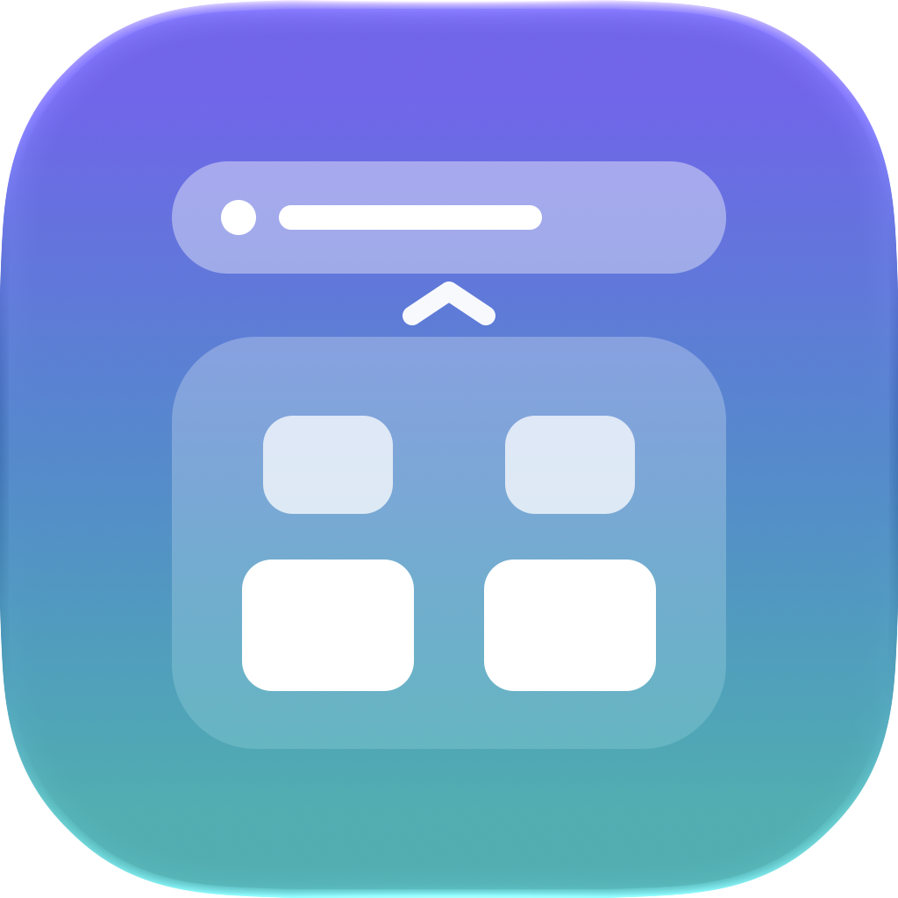
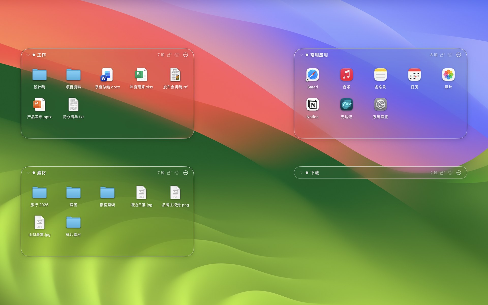
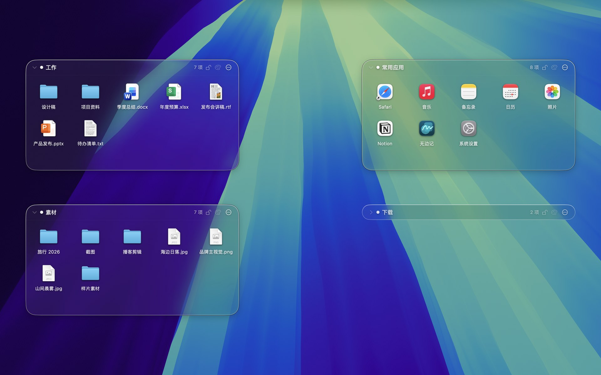
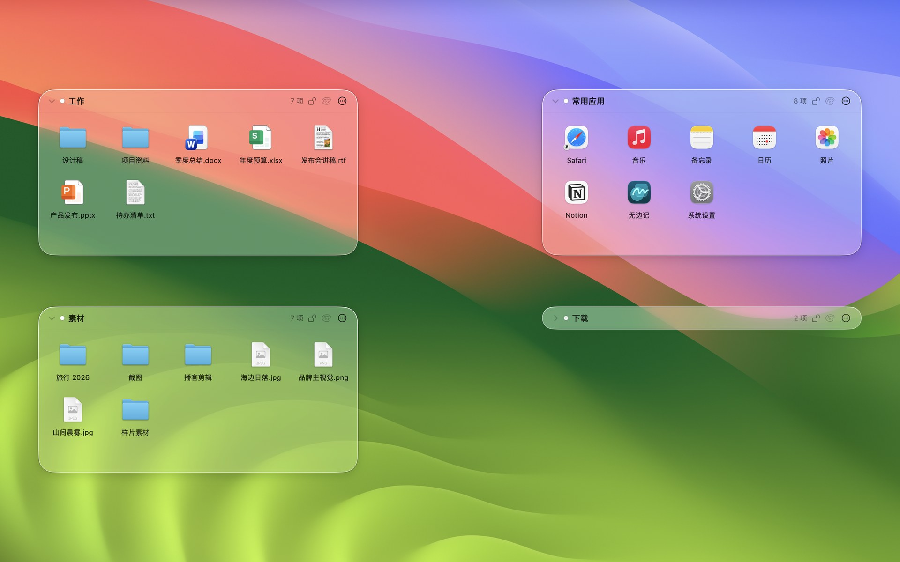
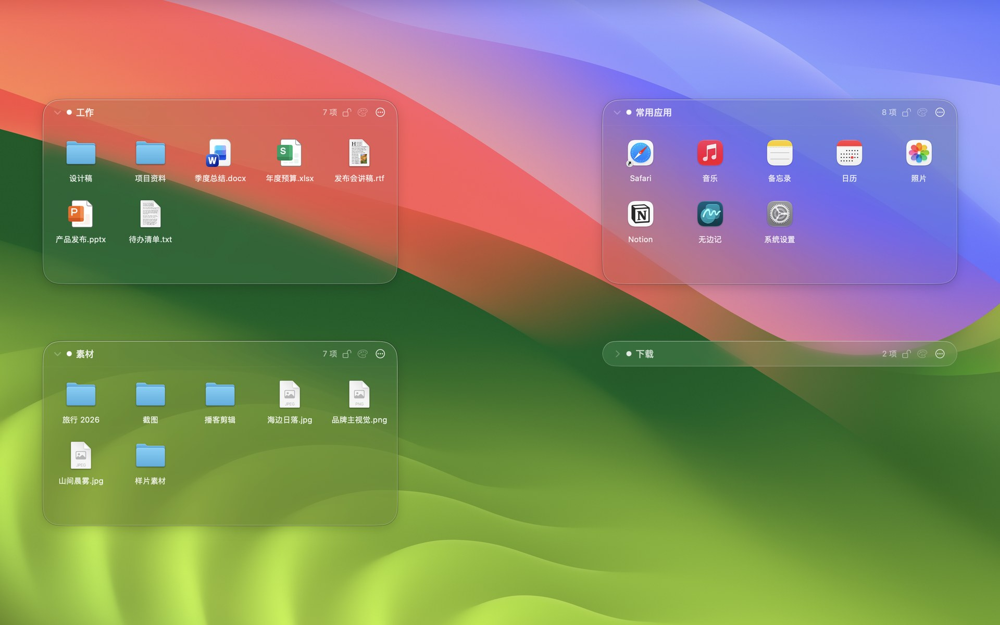
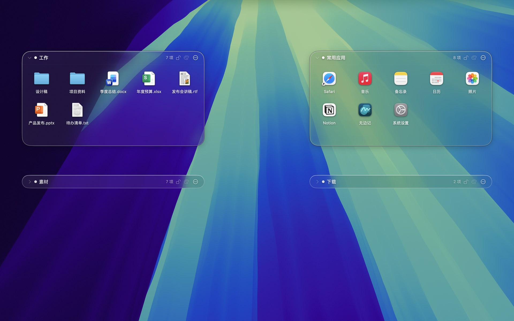
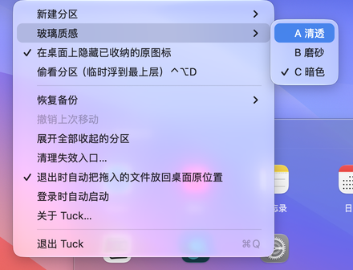
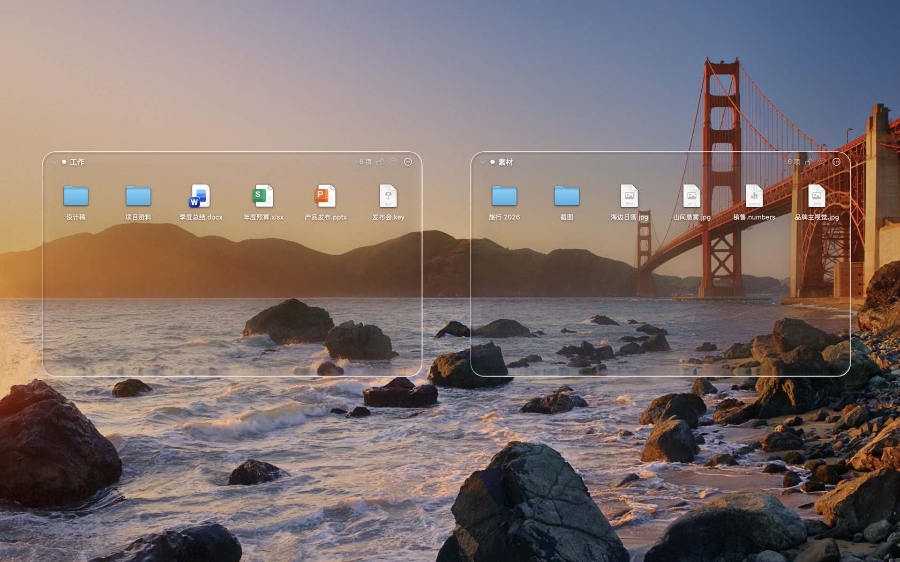
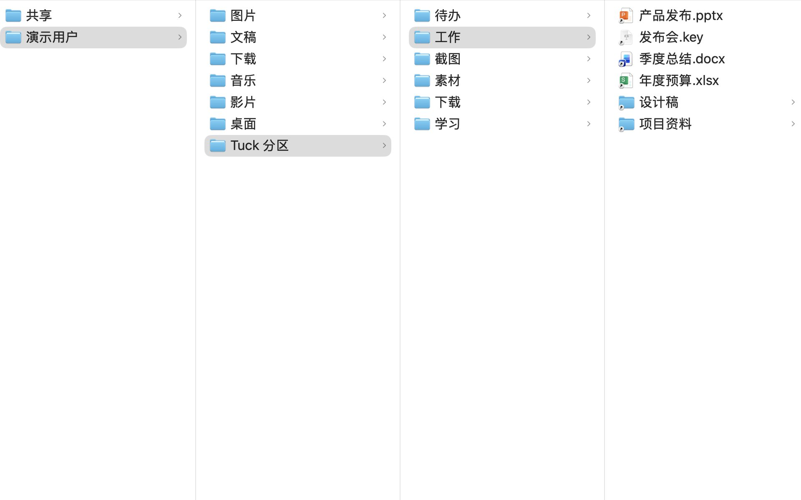

<div align="center">



<h1>Tuck</h1>

<p><b>把桌面上的东西，轻轻收进一块玻璃里。</b><br>免费开源的 macOS 桌面分区工具：液态玻璃、只在菜单栏、不动你的原文件。</p>

<p><b>中文</b> · <a href="README.en.md">English</a></p>

[](https://github.com/3520566741-YCLi/tuck-for-mac/releases/latest)
[](https://github.com/3520566741-YCLi/tuck-for-mac/releases/latest)
[](LICENSE)


[](https://github.com/3520566741-YCLi/tuck-for-mac/stargazers)

<h3><a href="https://github.com/3520566741-YCLi/tuck-for-mac/releases/latest">⬇︎ 下载最新版 Tuck</a></h3>

<a href="#画廊"></a>

<p><a href="#它能做什么">功能</a> · <a href="#画廊">画廊</a> · <a href="#安装">安装</a> · <a href="#常见问题">常见问题</a> · <a href="#参与贡献">参与贡献</a> · <a href="#-版本历史--releases">版本历史</a></p>

</div>

## 最近更新

**v2.3.0**（2026-11-24）：**每个分区单独调质感**（质感 / 折射 / 边缘都在分区的调色板里）、**下载分区**、**新下载自动移进分区**（Safari / Chrome / Edge / Firefox / Arc 都行，不用改浏览器设置）。怎么用见下方 [新功能怎么用](#新功能怎么用v23)，全部版本见 [版本历史](#-版本历史--releases)。

## 新功能怎么用（v2.3）

**每个分区单独调质感**
- 在哪：分区标题栏右边的**调色板按钮**（和调颜色、透明度是同一个面板）。
- 质感：清透 / 磨砂 / 暗色；折射：关闭 / 边缘拉伸 / 光栅；边缘：细边 / 高光 / 厚边。点哪个就只改这个分区，鼠标停在选项上有说明。
- 菜单栏原来的「玻璃质感」总设置去掉了：升级后每个分区保持原来的样子，新建的分区默认 清透 + 边缘拉伸 + 细边。菜单栏「玻璃效果」里只留「动态壁纸也折射」「光随屏幕角度变化」两个开关。

**下载分区**
- 在哪：菜单栏 Tuck 图标 › 新建分区 › **下载分区…**
- 会在「Tuck 分区」文件夹（个人文件夹里，可拖到访达侧栏）建一个真实文件夹，比如 `~/Tuck 分区/下载`；里面的文件都显示在这个分区里，最新的排最前，下载中的临时文件不显示。
- Tuck 永远不会删这个文件夹；删掉分区也不会删里面的文件。

**新下载自动移进分区**（默认关）
- 在哪：菜单栏 Tuck 图标 › **新下载自动移进分区** › 选一个下载分区，或点「新建下载分区并移到这里…」。
- 打开后，任何浏览器（Safari、Chrome、Edge、Firefox、Arc 等）下载完成的文件，不管落在「下载」文件夹还是桌面，约 2 秒后会被**移进**这个分区的文件夹，原处不再保留，不会一份文件两个地方。不用改浏览器设置。这是 Tuck 唯一会移动文件的地方，只有你打开它才会移。
- 只收打开之后新下载完成的文件：下载途中的临时文件（.download、.crdownload、.part、.opdownload 等）不碰，原来就有的文件不碰；默认只收从网上下载的（截图、自己新建的文件不收，同一菜单里可以关掉「只收从网上下载的文件」）。
- 第一次打开会先说明一次，然后系统问能不能读「下载」文件夹，点「允许」。不小心点了不允许：系统设置 › 隐私与安全性 › 文件与文件夹 › Tuck › 打开「下载文件夹」，再回菜单选一次分区。
- 放回去：菜单栏「**撤销上次移动**」（⌘Z）把刚移进来的放回原处，或者直接把文件从分区拖出去。重名会自动加编号，绝不覆盖；分区里删除 = 移到废纸篓；退出 Tuck 时文件留在分区文件夹里，不会丢。

## 它是什么

想象桌面上放了几个**透明的玻璃收纳盒**：

- 盒子浮在桌面图标上面、普通窗口下面；
- 把文件拖进盒子，盒子里出现它的**入口**，原文件**留在原地不动**，只是在桌面上被悄悄藏起来；
- 盒子可以一下**收成一颗玻璃胶囊**，要用时再点开；
- 关掉 Tuck，桌面一切恢复原样；就算 Tuck 崩溃，一个 2MB 的小看门狗也会把藏起来的图标放回来。

## 它能做什么

| | 功能 | 一句话 |
|---|---|---|
| 🪟 | **液态玻璃分区** | 系统原生 Liquid Glass（macOS 26+，旧系统自动换成毛玻璃）。**每个分区单独选**质感：清透 / 磨砂 / 暗色（分区标题栏的调色板）。 |
| 🔍 | **会折射的玻璃** | 像真玻璃一样弯折背后的壁纸：**边缘拉伸**（默认）或**光栅玻璃**（长虹竖棱）；边缘可选细边 / 高光 / 厚边，MacBook 上高光**随屏幕开合角度**滑动。 |
| 💊 | **收起成胶囊** | 点标题左边的箭头，从下往上收成玻璃胶囊，弹簧动效；再点恢复原尺寸。 |
| 📁 | **三种分区** | 普通分区只存入口 · 应用分区放常用 App · 文件分区关联一个真实文件夹。 |
| 🫥 | **桌面不重复** | 放进分区的桌面文件，在桌面上自动隐藏；拿出来或退出 Tuck 就恢复。 |
| 🖱️ | **像访达一样用** | 选中、双击打开、空格快速查看、⌘O / ⌘A / ⌘C；拖进文件夹、拖到 App 上打开。**右键菜单和访达一样**：打开方式、简介、改名、副本、替身、压缩、标签、服务，删除只进废纸篓、可 ⌘Z。 |
| 🗂️ | **「Tuck 分区」入口** | 个人文件夹里按分区列出原文件的替身，别的软件「打开 / 上传」时也找得到被收起的文件。 |
| 📥 | **下载分区** | 新建分区 › 下载分区：「Tuck 分区」里的真实文件夹，里面的文件都在分区里显示，访达侧栏也点得到。 |
| ⬇️ | **新下载自动移进分区** | 菜单「新下载自动移进分区」：任何浏览器下载完的文件（「下载」或桌面）自动移进下载分区，不用改浏览器设置；可撤销，默认关。 |
| 🔀 | **拖动排序** | 像手机桌面一样让位；在文件夹正中停一下就放进去。 |
| 🔤 | **自动排序** | 排序方式：名称 / 种类 / 日期 / 大小，可倒序，每个分区各自记住；只改显示顺序，绝不改名、不动文件。 |
| 👀 | **偷看** | 按 `⌃⌥D`，分区临时浮到所有窗口最上层。 |
| 🪶 | **几乎不占资源** | 闲置 0% CPU（只在文件夹变化时唤醒），日常约 22MB 内存，没有任何第三方依赖，不联网。 |

## 画廊

> 全部是 Mac 上的真实截图，分区里是演示文件。

#### 夜里自动跟着深色


#### 三种玻璃质感
| B 磨砂 | C 暗色 |
|:---:|:---:|
|  |  |

#### 收起成胶囊 · 菜单栏
| 展开与胶囊 | 菜单栏菜单 |
|:---:|:---:|
|  |  |

#### 会折射的玻璃 <sup>v2.2</sup>
| 边缘拉伸（默认） | 光栅玻璃 |
|:---:|:---:|
|  |  |

#### 访达同款右键 · 「Tuck 分区」入口 <sup>v2.2</sup>
| 右键菜单 | 上传时从「Tuck 分区」找文件 |
| :---: | |
|  | |

## 安装

### 直接下载（推荐）

1. 在 [Releases 最新版](https://github.com/3520566741-YCLi/tuck-for-mac/releases/latest) 下载 `Tuck-x.y.z.zip`，解压；
2. 把 `Tuck.app` 拖进「应用程序」；
3. 第一次打开：在「应用程序」里**右键 Tuck → 打开**（没有付费开发者签名，系统会提示一次）；
4. 菜单栏出现四宫格图标 → **新建分区**，把桌面文件拖进去。

所有旧版本都保留在 [Releases](https://github.com/3520566741-YCLi/tuck-for-mac/releases)，想回退随时能下。版本号按[语义化版本](https://semver.org/lang/zh-CN/)。

### 从源码构建 / 交给你的 AI

需要完整的 Xcode 26。也可以直接把仓库交给你的 AI 编程助手，让它照着 [AI_SETUP.md](AI_SETUP.md) 装。

```sh
git clone https://github.com/3520566741-YCLi/tuck-for-mac.git && cd tuck-for-mac
swift test --disable-sandbox --cache-path .spm-cache   # 跑测试
./scripts/package-app.sh --install                      # 打包并装到 /Applications
```

## 常见问题

<details><summary><b>会不会动我的文件？</b></summary>

普通分区和应用分区**只存入口，绝不移动原文件**。桌面上的隐藏只是给文件打一个访达隐藏标记（和 `chflags hidden` 一样），文件不改名、不移动、不改内容。只有你主动建的「文件分区」才会把拖进来的文件移进它关联的文件夹，而且同名冲突默认是「取消」，替换掉的旧文件进废纸篓，可以撤销。
</details>

<details><summary><b>Tuck 崩溃了，桌面图标会不会一直藏着？</b></summary>

不会。Tuck 启动时会带起一个约 2MB 的看门狗进程，Tuck 意外退出时它会把 Tuck 藏起来的桌面图标恢复。它只恢复 Tuck 自己藏的，你原本就隐藏的文件不碰。
</details>

<details><summary><b>为什么分区不在 Dock 里？</b></summary>

Tuck 只在菜单栏，所有设置都在那个四宫格图标里。从启动台再次打开 Tuck 会弹出菜单栏菜单。
</details>

<details><summary><b>旧系统能用吗？</b></summary>

macOS 14 起能用，液态玻璃需要 macOS 26；旧系统会自动换成系统毛玻璃。
</details>

<details><summary><b>要给什么权限？会不会偷看屏幕？</b></summary>

默认**什么权限都不要**，也不联网。只有你在菜单里打开「动态壁纸也折射」时才会请求一次「录屏」权限：系统动态 / 航拍壁纸不把画面交给 App，Tuck 只截壁纸那一层（截不到任何窗口、桌面图标和文件），只在内存里用、不存盘。用普通图片壁纸就不需要它。因为没有付费开发者签名，每次升级 Tuck 后系统可能要你重新允许一次。
</details>

<details><summary><b>个人文件夹里多出来的「Tuck 分区」是什么？</b></summary>

被收进分区的桌面文件在桌面上是隐藏的，这个隐藏对所有软件都生效，所以别的软件的「打开 / 上传」窗口里也看不到它们。「Tuck 分区」按分区列出指向原文件的替身，上传时点进去就能选到原文件。删掉里面的替身不会删到原文件；不需要的话在菜单栏关掉「在个人文件夹放『Tuck 分区』入口」。
</details>

<details><summary><b>会开机自启吗？</b></summary>

默认不会。需要的话在菜单栏打开「登录时自动启动」。
</details>

<details><summary><b>某个文件的图标后面有块黑底？</b></summary>

Tuck 显示的是系统给的图标。有的应用（比如把 PDF 默认交给某些第三方软件打开时）提供的图标本身带不透明底色，访达里看也是一样的。
</details>

## 路线图

- [ ] 分区标签页（一个分区里分几页）
- [ ] 按规则自动整理新文件（可选，默认关闭）
- [ ] 更多玻璃色调

## 参与贡献

欢迎提 issue 和 PR，先看 [CONTRIBUTING.md](CONTRIBUTING.md)。安全问题请按 [SECURITY.md](SECURITY.md) 私下报告。

## 致谢

产品行为参考了 Windows 上的 [DesktopFramesPlus](https://github.com/limbo666/DesktopFramesPlus)（MIT）。Tuck 用 Swift / AppKit 为 macOS 重新实现，没有复制它的代码。详见 [THIRD_PARTY_NOTICES.md](THIRD_PARTY_NOTICES.md)。

## 📦 版本历史 / Releases

| 版本 | 日期 | 这一版改了什么 | 下载 |
|---|---|---|---|
| **v2.3.0** `最新` | 2026-11-24 | 每个分区单独调质感、下载分区、新下载自动移进分区（所有浏览器） · [详细](CHANGELOG.md#v230--2026-11-24) | [下载](https://github.com/3520566741-YCLi/tuck-for-mac/releases/tag/v2.3.0) |
| **v2.2.0** | 2026-11-24 | 更真的液态玻璃、自动排序、会折射的玻璃（边缘拉伸 / 光栅，动态壁纸也行）、新边缘光效 + 光随屏幕角度、访达同款右键菜单、「Tuck 分区」入口、英文界面 · [详细](CHANGELOG.md#v220--2026-11-24) | [下载](https://github.com/3520566741-YCLi/tuck-for-mac/releases/tag/v2.2.0) |
| **v2.1.0** | 2026-11-08 | 第一次公开发布：液态玻璃分区三种质感、收成胶囊、桌面自动隐藏、像访达一样操作、崩溃看门狗 · [详细](CHANGELOG.md#v210--2026-11-08) | [下载](https://github.com/3520566741-YCLi/tuck-for-mac/releases/tag/v2.1.0) |

所有版本都一直保留在 [Releases](https://github.com/3520566741-YCLi/tuck-for-mac/releases)，每个版本页的 **Assets** 里有安装包。

## 许可证

[MIT](LICENSE)
